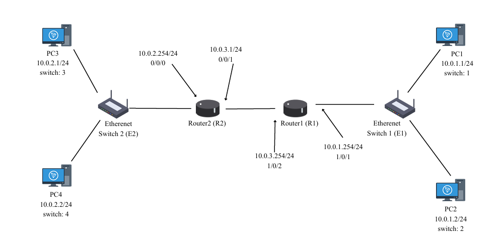

# Basic Routing — Static Routing & RIPv2 

## Overview

This simulation demonstrates communication between two departmental LANs using static routing and dynamic routing (RIPv2) in Cisco Packet Tracer. Both implementations use the same network topology and IPv4 addressing scheme to illustrate the differences between manual route configuration and automatic route discovery.

## Network Topology

<p align="center">
  
</p>

The network consists of two Cisco ISR4331 routers, two Ethernet switches, four PCs and three IPv4 subnets.

## IP Address Allocation

| Network | Subnet | Default gateway |
|---|---|---|
| CO Department | 10.0.1.0/24 | 10.0.1.254 |
| EE Department | 10.0.2.0/24 | 10.0.2.254 |
| Inter-router link | 10.0.3.0/24 | — |

## Static Routing

Remote networks are reached through manually configured next-hop routes.

**R1**

```cisco
ip route 10.0.2.0 255.255.255.0 10.0.3.1
```

**R2**

```cisco
ip route 10.0.1.0 255.255.255.0 10.0.3.254
```

The remote networks appear as `S` entries in the routing tables, with an administrative distance of 1.

## Dynamic Routing — RIPv2

Static routes are removed and RIPv2 is configured on both routers to automatically discover remote networks.

```cisco
router rip
 version 2
 no auto-summary
 network 10.0.0.0
```

The remote networks appear as `R` entries, with an administrative distance of 120 and a hop count of 1.

## Routing Table Verification

| Router | Remote network | Next hop | Static | RIPv2 |
|---|---|---|---|---|
| R1 | 10.0.2.0/24 | 10.0.3.1 | S [1/0] | R [120/1] |
| R2 | 10.0.1.0/24 | 10.0.3.254 | S [1/0] | R [120/1] |

## Connectivity Testing

Use the following commands to verify routing and connectivity:

```cisco
show ip route
show ip protocols
```

From PC1's command prompt:

```bash
ping 10.0.1.2
ping 10.0.2.2
tracert 10.0.2.2
```

These tests check local communication, inter-subnet connectivity and the packet forwarding path.

## Simulation Files

- [Static routing](static-routing.pkt)
- [Dynamic routing (RIPv2)](dynamic-routing-ripv2.pkt)

Open either file in Cisco Packet Tracer to inspect the configuration and reproduce the tests.

## Academic Context

Originally developed as part of CO2208 — Computer Networks, Semester 4, University of Sri Jayewardenepura.

