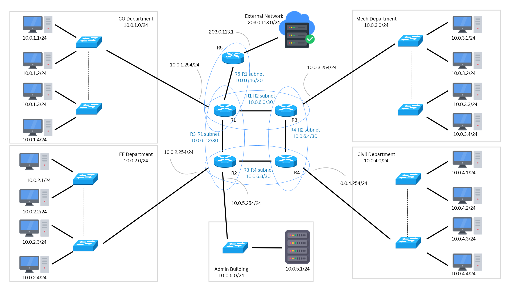
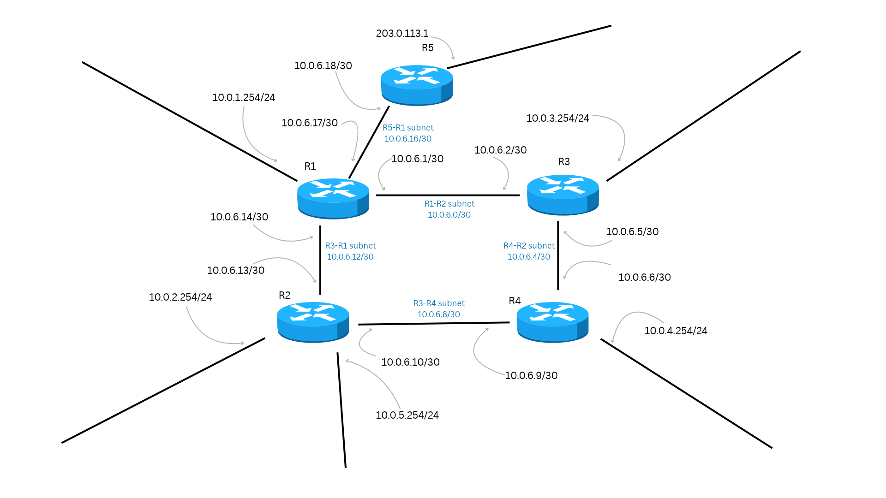

# Multi-Router Campus Network

A Cisco Packet Tracer simulation of a departmental campus network with a redundant router backbone, central administration services and a simulated external network. The project provides a common topology for studying dynamic routing, path selection, resilience, hierarchical routing, routing authentication and edge network services.

## Objectives

- Design a segmented IPv4 campus network using variable-length subnet masks (VLSM).
- Configure Ethernet and serial router interfaces and verify directly connected networks.
- Provide redundant paths between departmental routers.
- Evaluate dynamic routing protocols on an identical physical topology.
- Investigate route convergence, equal-cost paths and simulated external access using NAT/PAT.
- Demonstrate OSPF cost-based routing, automatic failover, multi-area architecture and routing authentication.

## Physical network topology



The network contains four engineering departments, each with four PCs and two interconnected access switches. A central administration server connects through a dedicated switch to R2. Four Cisco 2911 routers form a serial ring, and an ISR4331 edge router (R5) connects R1 to an external server. The external network represents an isolated simulated Internet service, not the real Internet.

| Router | Role | Model |
|---|---|---|
| R1 | Computer Engineering and edge uplink | Cisco 2911 |
| R2 | Electrical Engineering and Administration | Cisco 2911 |
| R3 | Mechanical Engineering | Cisco 2911 |
| R4 | Civil Engineering | Cisco 2911 |
| R5 | Edge router | Cisco ISR4331 |

## Logical topology and interface addressing



The ring follows R1–R3–R4–R2–R1, with an additional Ethernet connection from R1 to R5. The ring provides alternate internal paths; the single edge uplink remains a single point of failure for external access.

### LAN addressing

| Network | Subnet | Host addresses | Default gateway |
|---|---|---|---|
| Computer Engineering (CO) | 10.0.1.0/24 | 10.0.1.1–10.0.1.4 | 10.0.1.254 |
| Electrical Engineering (EE) | 10.0.2.0/24 | 10.0.2.1–10.0.2.4 | 10.0.2.254 |
| Mechanical Engineering (ME) | 10.0.3.0/24 | 10.0.3.1–10.0.3.4 | 10.0.3.254 |
| Civil Engineering (CE) | 10.0.4.0/24 | 10.0.4.1–10.0.4.4 | 10.0.4.254 |
| Administration | 10.0.5.0/24 | 10.0.5.1 | 10.0.5.254 |
| External server | 203.0.113.0/24 | 203.0.113.10 | 203.0.113.1 |

All LANs use mask `255.255.255.0`. The external range is TEST-NET-3, reserved for documentation.

### Backbone subnet allocation

| Link | Subnet | Endpoint A | Endpoint B | Broadcast |
|---|---|---|---|---|
| R1–R3 | 10.0.6.0/30 | 10.0.6.1 | 10.0.6.2 | 10.0.6.3 |
| R3–R4 | 10.0.6.4/30 | 10.0.6.5 | 10.0.6.6 | 10.0.6.7 |
| R4–R2 | 10.0.6.8/30 | 10.0.6.9 | 10.0.6.10 | 10.0.6.11 |
| R2–R1 | 10.0.6.12/30 | 10.0.6.13 | 10.0.6.14 | 10.0.6.15 |
| R1–R5 | 10.0.6.16/30 | 10.0.6.17 | 10.0.6.18 | 10.0.6.19 |

Each point-to-point link uses `255.255.255.252`, providing exactly two usable IPv4 addresses. Using /24 LANs and /30 backbone links demonstrates VLSM and avoids allocating an entire /24 to each router link.

### Router interface assignments

| Router | Interface | IPv4 address | Connection |
|---|---|---|---|
| R1 | Gi0/0 | 10.0.1.254/24 | CO LAN |
| R1 | Gi0/1 | 10.0.6.17/30 | R5 |
| R1 | Se0/3/0 | 10.0.6.1/30 | R3 (DCE) |
| R1 | Se0/3/1 | 10.0.6.14/30 | R2 (DCE) |
| R2 | Gi0/0 | 10.0.2.254/24 | EE LAN |
| R2 | Gi0/1 | 10.0.5.254/24 | Admin LAN |
| R2 | Se0/3/0 | 10.0.6.13/30 | R1 |
| R2 | Se0/3/1 | 10.0.6.10/30 | R4 (DCE) |
| R3 | Gi0/0 | 10.0.3.254/24 | ME LAN |
| R3 | Se0/3/0 | 10.0.6.2/30 | R1 |
| R3 | Se0/3/1 | 10.0.6.5/30 | R4 |
| R4 | Gi0/0 | 10.0.4.254/24 | CE LAN |
| R4 | Se0/3/0 | 10.0.6.9/30 | R2 |
| R4 | Se0/3/1 | 10.0.6.6/30 | R3 (DCE) |
| R5 | Gi0/0/0 | 10.0.6.18/30 | R1 |
| R5 | Gi0/0/1 | 203.0.113.1/24 | External server |

## Base configuration

The 2911 routers use HWIC-2T serial modules. Serial DCE interfaces supply clocking at 64000 bps. Access switches operate at Layer 2; departmental segmentation is achieved through separate routed LANs rather than a shared VLAN trunk architecture.

Example configuration on R1:

```cisco
enable
configure terminal
interface GigabitEthernet0/0
 description CO LAN
 ip address 10.0.1.254 255.255.255.0
 no shutdown
exit
interface Serial0/3/0
 description Link to R3
 ip address 10.0.6.1 255.255.255.252
 clock rate 64000
 no shutdown
end
write memory
```

Verify interface status and directly connected routes:

```cisco
show ip interface brief
show ip route
show controllers serial 0/3/0
```

Test each host's default gateway and adjacent router addresses using `ping`. The base simulation intentionally does not provide complete interdepartmental routing or NAT/PAT; those features belong to the protocol-specific implementations.

## Routing implementations

| Implementation | Status | Documentation |
|---|---|---|
| RIPv2 | Implemented | [RIPv2 experiment](ripv2/README.md) |
| OSPFv2 | Implemented | [OSPF experiments](03-ospf-routing/README.md) |
| EIGRP | Planned | DUAL, composite metrics and convergence comparison |

Full static routing is not repeated here because it was demonstrated in the preceding basic network project. The extended topology focuses on dynamic routing and resilience.

### RIPv2 — Distance-vector routing

The RIPv2 implementation establishes dynamic routing across the campus using hop count as its metric. It provides the foundation for studying route exchange, redundant paths and edge services using NAT/PAT in the simulated external network.

See the [RIPv2 documentation](ripv2/README.md) for configuration and observations.

### OSPF — Link-state routing

The OSPF implementation reuses the same physical topology and addressing scheme. A single-area Area 0 baseline establishes neighbor adjacencies, link-state databases (LSDBs), shortest-path routing and equal-cost multipath routes. Four subsequent experiments investigate specific protocol capabilities without repeating the basic network setup.

| Experiment | Key observation | Documentation | Simulation |
|---|---|---|---|
| Baseline | FULL adjacencies, consistent LSA identities and versions on R1 and R4, and equal-cost routes to the Civil LAN | [Baseline observations](03-ospf-routing/README.md) | [Packet Tracer](03-ospf-routing/ospf-baseline.pkt) |
| 01 — Cost-based routing | Increasing the direct interface cost from 64 to 250 selects a longer path with total cost 193 | [README](03-ospf-routing/01-cost-based-routing/README.md) | [Packet Tracer](03-ospf-routing/01-cost-based-routing/ospf-cost-routing.pkt) |
| 02 — Network resilience | Link failure triggers alternate route selection; continuous ping records 220 of 221 replies | [README](03-ospf-routing/02-network-resilience/README.md) | [Packet Tracer](03-ospf-routing/02-network-resilience/ospf-redundant-network.pkt) |
| 03 — Multi-area OSPF | Area Border Routers, inter-area routes (`O IA`) and Type 3 Summary LSAs | [README](03-ospf-routing/03-multi-area-ospf/README.md) | [Packet Tracer](03-ospf-routing/03-multi-area-ospf/ospf-multi-area.pkt) |
| 04 — Secure OSPF | Matching MD5 keys permit adjacency; mismatched keys cause adjacency loss and rerouting; correcting the key restores adjacency | [README](03-ospf-routing/04-secure-ospf/README.md) | [Packet Tracer](03-ospf-routing/04-secure-ospf/ospf-authentication.pkt) |

### RIPv2 and OSPF comparison

| Feature | RIPv2 | OSPFv2 |
|---|---|---|
| Routing approach | Distance-vector | Link-state |
| Metric | Hop count | Cumulative interface cost |
| Path calculation | Distance-vector algorithm | Dijkstra's shortest-path-first algorithm |
| Network hierarchy | Flat routing domain | Backbone and multiple areas |
| Routing updates | Periodic and triggered updates | Event-driven LSA flooding with periodic refresh |
| Maximum usable hop count | 15 | No RIP-style 15-hop limit |
| Equal-cost multipath | Supported | Supported |
| Authentication | Supports MD5 | Supports MD5 and stronger mechanisms on compatible platforms; integrates with adjacency and area configuration |

The OSPF experiments demonstrate greater control over path selection, hierarchical routing and authenticated adjacency management. Both protocols support redundancy and authentication; these features are not exclusive to OSPF. OSPF generally offers faster convergence, but this project does not establish a controlled quantitative convergence comparison between the protocols.

## Running the simulation

1. Open [extended-network-base.pkt](extended-network-base.pkt) in Cisco Packet Tracer to inspect the unmodified base network.
2. Open the [RIPv2 documentation](ripv2/README.md) or [OSPF documentation](03-ospf-routing/README.md) and select the corresponding simulation.
3. Use the interface addressing table and protocol README to inspect and verify the configuration.
4. Reproduce the experiments using separate Packet Tracer files to preserve the baseline and isolate configuration changes.

## Tools and scope

Cisco Packet Tracer, Cisco IOS CLI, IPv4, VLSM, Ethernet, serial WAN links, RIPv2, OSPFv2 and simulated NAT/PAT. This is an educational simulation; performance and convergence observations are not production hardware benchmarks. Redundancy is limited to the internal ring, and no production firewall, ISP or high-availability edge design is implied.

The multi-area experiment demonstrates hierarchy rather than measuring scalability at production scale. MD5 authentication is used for lab compatibility on one tested link; it does not encrypt traffic or secure the entire routing domain. External connectivity and NAT/PAT are not claimed as verified in the OSPF experiments.
