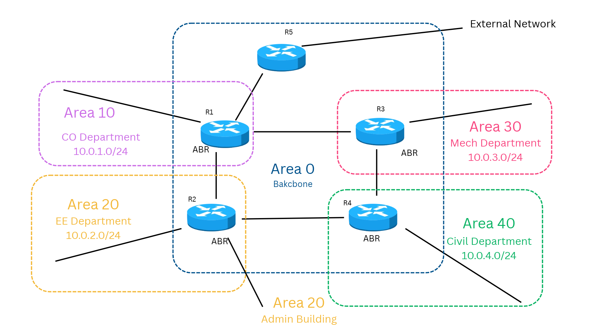

# Multi-Area OSPF

## 1. Objective

Implement hierarchical OSPF routing using multiple areas and demonstrate Area Border Routers (ABRs), inter-area route advertisements, area-specific link-state databases (LSDBs), and connectivity across departmental networks using Cisco Packet Tracer.

## 2. Network Architecture

The existing five-router topology is retained. All inter-router links remain in backbone Area 0, while departmental LANs are assigned to separate non-backbone areas. The manually configured cost from Experiment 01 is removed to isolate the effects of area allocation.



| Area | Network | Department | Router |
|---|---|---|---|
| 0 | 10.0.6.0/30, 10.0.6.4/30, 10.0.6.8/30, 10.0.6.12/30, 10.0.6.16/30 | Backbone | R1–R5 |
| 10 | 10.0.1.0/24 | Computer Engineering | R1 |
| 20 | 10.0.2.0/24 | Electrical and Electronic Engineering | R2 |
| 20 | 10.0.5.0/24 | Administration | R2 |
| 30 | 10.0.3.0/24 | Mechanical Engineering | R3 |
| 40 | 10.0.4.0/24 | Civil Engineering | R4 |

R1–R4 operate as ABRs by connecting their respective departmental areas to Area 0. R5 remains a backbone router. External network routing is outside the scope of this experiment.


## 3. Configuration

The existing OSPF process (process ID 1) is retained. On R1, the manually assigned serial interface cost is removed:

```cisco
configure terminal
interface Serial0/3/0
 no ip ospf cost
end
```

The departmental network statements are reassigned as follows, leaving the transit networks unchanged.

### R1 — Area 10

```cisco
configure terminal
router ospf 1
 no network 10.0.1.0 0.0.0.255 area 0
 network 10.0.1.0 0.0.0.255 area 10
end
```

### R2 — Area 20

```cisco
configure terminal
router ospf 1
 no network 10.0.2.0 0.0.0.255 area 0
 no network 10.0.5.0 0.0.0.255 area 0
 network 10.0.2.0 0.0.0.255 area 20
 network 10.0.5.0 0.0.0.255 area 20
end
```

### R3 — Area 30

```cisco
configure terminal
router ospf 1
 no network 10.0.3.0 0.0.0.255 area 0
 network 10.0.3.0 0.0.0.255 area 30
end
```

### R4 — Area 40

```cisco
configure terminal
router ospf 1
 no network 10.0.4.0 0.0.0.255 area 0
 network 10.0.4.0 0.0.0.255 area 40
end
```

No area reassignment is required on R5.

## 4. Observations and Results

### 4.1 Area Border Router verification

Command: `show ip ospf` on R1.


R1 is explicitly identified as an Area Border Router. It participates in two normal areas: Area 0 with three interfaces and Area 10 with one interface.

### 4.2 Interface area allocation

Command: `show ip ospf interface brief` on R1.


| Interface | Area | Cost |
|---|---:|---:|
| Gig0/1 | 0 | 1 |
| Se0/3/0 | 0 | 64 |
| Se0/3/1 | 0 | 64 |
| Gig0/0 | 10 | 1 |

The output confirms that the CO LAN is assigned to Area 10 and the transit interfaces remain in Area 0. The serial interface cost has returned to 64. Neighbor counts in this brief output are not used to establish adjacency status.

### 4.3 Inter-area routing

Command: `show ip route ospf` on R1.


| Destination | Route type | Administrative distance | Cost | Next hop |
|---|---|---:|---:|---|
| 10.0.2.0/24 | O IA | 110 | 65 | 10.0.6.13 |
| 10.0.3.0/24 | O IA | 110 | 65 | 10.0.6.2 |
| 10.0.4.0/24 | O IA | 110 | 129 | 10.0.6.2 and 10.0.6.13 |
| 10.0.5.0/24 | O IA | 110 | 65 | 10.0.6.13 |
| 10.0.6.4/30 | O | 110 | 128 | 10.0.6.2 |
| 10.0.6.8/30 | O | 110 | 128 | 10.0.6.13 |

`O IA` identifies inter-area routes, while `O` identifies intra-area routes. The Civil Department retains two equal-cost paths, demonstrating that ECMP remains available with multi-area OSPF.

### 4.4 Area-specific link-state databases

Command: `show ip ospf database` on R1 and R2.

**R1 — Areas 0 and 10**


**R2 — Areas 0 and 20**


Both routers display the five backbone Router LSAs (Type 1), a Network LSA (Type 2) for the R1–R5 Ethernet segment, and Summary Network LSAs (Type 3) for departmental networks. R1 additionally maintains Area 10 information, whereas R2 maintains Area 20 information. ABRs advertise reachability between areas using Type 3 LSAs rather than flooding the original area-specific Router LSAs across area boundaries.

The backbone LSA identities agree, but sequence numbers and checksums differ between the two captures. These screenshots demonstrate area separation, not exact simultaneous LSDB synchronization; a fresh comparison after convergence would be required to verify matching LSA versions.

### 4.5 Inter-area connectivity


Tests were performed from CO-PC1 in Area 10.

| Destination | Area | Test | Observed result |
|---|---:|---|---|
| 10.0.4.3 | 40 | Ping | 4/4 replies, 0% loss |
| 10.0.3.3 | 30 | Ping | 4/4 replies, 0% loss |
| 10.0.5.1 | 20 | Traceroute | Destination reached via R1 and R2; one probe timed out |
| 10.0.4.1 | 40 | Ping | 3/4 replies, 25% loss |

The tests confirm reachability across the tested areas. The first ping to 10.0.4.1 timed out, followed by three successful replies. Initial ARP resolution is a possible explanation, but the exact cause was not measured.

## 5. Comparison with Single-Area OSPF and RIPv2

| Feature | RIPv2 | Single-area OSPF | Multi-area OSPF |
|---|---|---|---|
| Architecture | Flat | Single link-state area | Hierarchical |
| Routing metric | Hop count | Cumulative cost | Cumulative cost |
| Area Border Routers | Not supported | Not required | Supported |
| Link-state database | Not applicable | Area-wide | Area-specific |
| Inter-area route advertisements | Not applicable | Not applicable | Type 3 Summary LSAs |

Multi-area OSPF limits the scope of area-specific topology information and supports hierarchical routing. Type 3 LSAs advertise network reachability; manual prefix aggregation is not configured in this experiment. The small topology demonstrates these mechanisms but does not quantify scalability, flooding reductions, or convergence performance.

## 6. Conclusion

The experiment successfully demonstrated hierarchical routing using multi-area OSPF. The existing network was divided into a backbone area and four departmental areas without changing its physical topology or IP addressing. The routing tables confirmed inter-area route learning and equal-cost multipath routing, while the LSDB outputs demonstrated area-specific topology information and Type 3 Summary LSAs. Connectivity tests confirmed reachability across the tested areas, with isolated probe timeouts. The results illustrate the architectural capabilities that distinguish multi-area OSPF from flat routing protocols such as RIPv2.


