# RIPv2 — Multi-Router Campus Network

Implementation of Routing Information Protocol version 2 (RIPv2) on a five-router campus network, including dynamic route discovery, equal-cost multipath routing, backbone failure recovery, default route propagation and Port Address Translation (PAT) for simulated external access.

[Parent network documentation](../README.md) · [Packet Tracer simulation](dynamic-routing-ripv2.pkt)

## 1. Objectives

- Exchange IPv4 routes dynamically across five routers.
- Support /24 LANs and /30 backbone subnets without classful summarization.
- Prevent unnecessary routing advertisements on end-device LANs.
- Verify internal connectivity and equal-cost routes.
- Simulate a backbone failure and observe alternative path selection and restoration.
- Propagate a default route and provide external HTTP access using NAT overload.

## 2. Network architecture

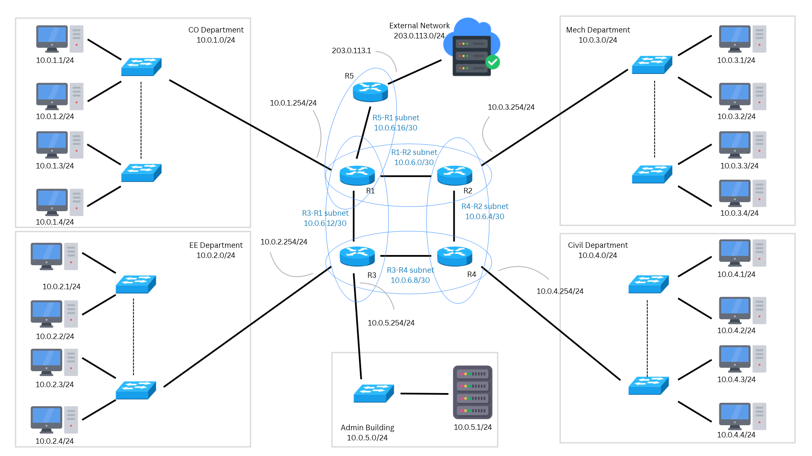

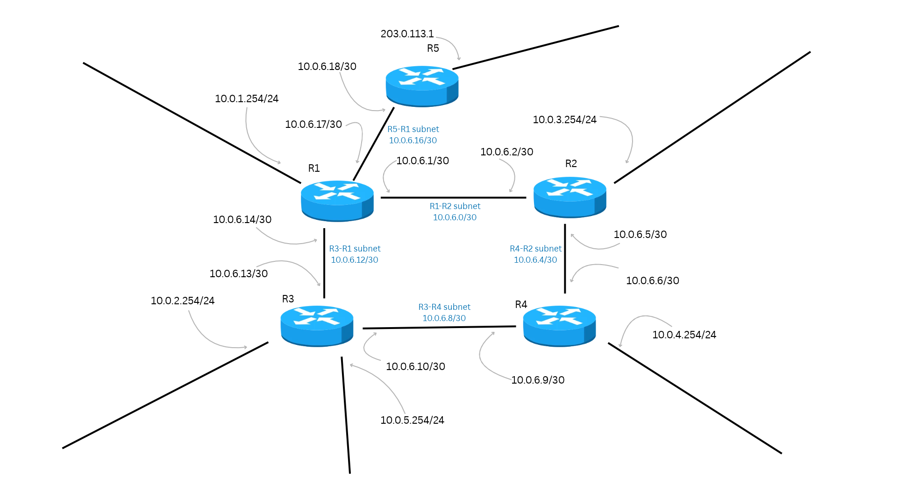

R1, R2, R3 and R4 form a redundant ring; R5 connects the ring to the external server network. All internal interfaces use addresses within 10.0.0.0/8. The external subnet 203.0.113.0/24 is excluded from RIP advertisements. See the [parent README](../README.md) for the full interface and subnet allocation.

## 3. Protocol characteristics

| Property | RIPv2 |
|---|---|
| Type | Distance vector |
| Algorithm | Bellman–Ford based |
| Metric | Hop count |
| Administrative distance | 120 |
| Maximum reachable metric | 15 hops |
| Unreachable metric | 16 hops |
| Periodic update interval | 30 seconds |
| Default invalid / holddown / flush timers | 180 / 180 / 240 seconds |
| Transport | UDP port 520 |
| Multicast updates | 224.0.0.9 |
| VLSM support | Yes |

RIPv2 selects paths by hop count, not bandwidth or delay. Triggered updates can advertise changes before the next periodic update. Convergence is not guaranteed to occur within one update interval.

## 4. Router configuration

The following commands are applied from privileged EXEC mode on the configured base topology.

### R1 — Computer Engineering

```cisco
configure terminal
router rip
 version 2
 no auto-summary
 network 10.0.0.0
 passive-interface GigabitEthernet0/0
end
write memory
```

### R2 — Electrical Engineering and Administration

```cisco
configure terminal
router rip
 version 2
 no auto-summary
 network 10.0.0.0
 passive-interface GigabitEthernet0/0
 passive-interface GigabitEthernet0/1
end
write memory
```

### R3 — Mechanical Engineering

```cisco
configure terminal
router rip
 version 2
 no auto-summary
 network 10.0.0.0
 passive-interface GigabitEthernet0/0
end
write memory
```

### R4 — Civil Engineering

```cisco
configure terminal
router rip
 version 2
 no auto-summary
 network 10.0.0.0
 passive-interface GigabitEthernet0/0
end
write memory
```

### R5 — Edge router (initial configuration)

```cisco
configure terminal
router rip
 version 2
 no auto-summary
 network 10.0.0.0
end
write memory
```

The `network` command activates RIP on matching interfaces. Passive LAN interfaces remain advertised through active router-facing interfaces but do not send periodic RIP updates to end devices. Disabling automatic summarization preserves subnet information across the network. R5's external interface is not matched by the RIP network statement.

## 5. Routing verification

```cisco
show ip route
show ip protocols
show ip route rip
```

`R` identifies a RIP-learned route, `C` a connected network and `L` a local interface address. In `[120/2]`, 120 is administrative distance and 2 is the RIP metric.

<details>
<summary>R1–R5 routing tables before default route propagation</summary>

### R1


### R2


### R3


### R4


### R5


</details>

R5 was observed learning all five internal LANs through R1:

| Destination | Next hop | Observed metric |
|---|---|---:|
| 10.0.1.0/24 | 10.0.6.17 | 1 |
| 10.0.2.0/24 | 10.0.6.17 | 2 |
| 10.0.3.0/24 | 10.0.6.17 | 2 |
| 10.0.4.0/24 | 10.0.6.17 | 3 |
| 10.0.5.0/24 | 10.0.6.17 | 2 |

### Troubleshooting observation

Initially R2 was missing `network 10.0.0.0`, so it did not exchange RIP routes and the EE and administration networks were absent from other routers' routing tables. Adding the network statement restored RIP participation; R5 subsequently learned both missing networks. This illustrates the importance of checking `show ip protocols` as well as routing tables.

## 6. Internal connectivity

From CO-PC1:

```cmd
tracert 10.0.2.1
tracert 10.0.3.1
ping 10.0.4.1
ping 10.0.5.1
tracert 10.0.4.1
```

The ME PC and administration server ping results were directly observed with four replies and zero packet loss. The remaining destinations are included in the verification procedure.

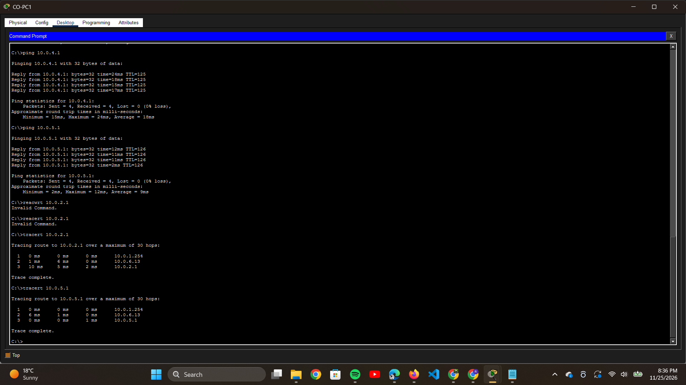


### Equal-cost multipath routing (ECMP)

R2 was observed learning two equal-cost routes to the ME LAN:

```text
R 10.0.3.0/24 [120/2] via 10.0.6.14
              [120/2] via 10.0.6.9
```

The paths are R2 → R1 → R3 and R2 → R4 → R3. Both have metric 2. This confirms multiple equal-cost next hops are installed, but does not by itself measure traffic distribution between them.

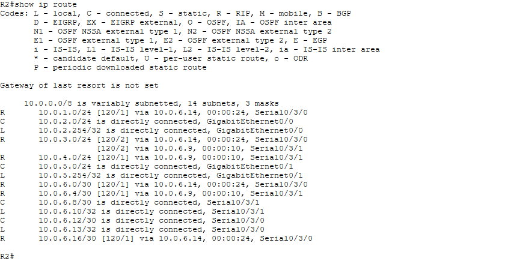

## 7. Backbone link failure and recovery

### Experimental procedure

The R1–R3 serial link is temporarily disabled to test reachability from CO-PC1 to ME-PC1 (`10.0.3.1`). The remaining ring links provide an alternative path.

Before failure, on R1:

```cisco
show ip route 10.0.3.0
```

From CO-PC1:

```cmd
ping 10.0.3.1
tracert 10.0.3.1
```

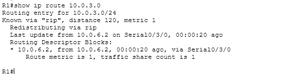

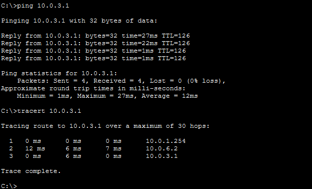

Disable the R1 interface:

```cisco
configure terminal
interface Serial0/3/0
 shutdown
end
```

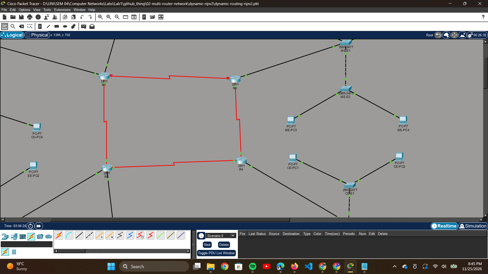

Repeat the ping immediately to observe any transient disruption. After convergence, inspect the route and repeat the traceroute and ping. Do not save the temporary shutdown as the final configuration.

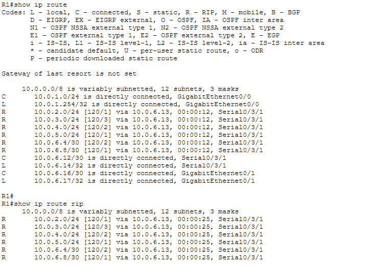

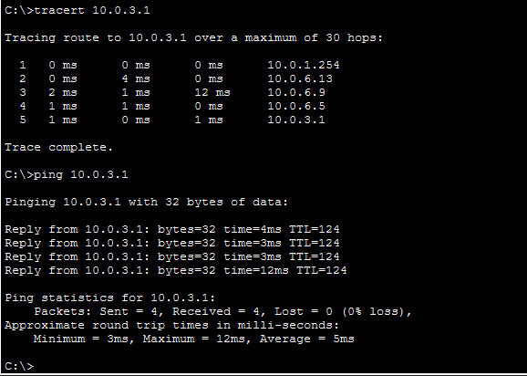

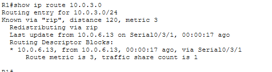

Restore the interface:

```cisco
configure terminal
interface Serial0/3/0
 no shutdown
end
```

Verify the original route returns, then save the restored configuration.

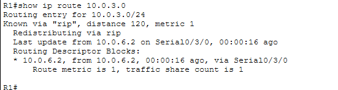

### Expected routing changes

| Parameter | Normal | After failure and convergence | Restored |
|---|---|---|---|
| Path | R1 → R3 | R1 → R2 → R4 → R3 | R1 → R3 |
| Next hop | 10.0.6.2 | 10.0.6.13 | 10.0.6.2 |
| RIP metric | 1 | 3 | 1 |
| Outgoing interface | Se0/3/0 | Se0/3/1 | Se0/3/0 |

The experiment is designed to demonstrate automatic route recalculation without manual route changes. No measured convergence duration or transient packet-loss count is reported here; those values require timed observations. The same link and endpoints can be used for later OSPF and EIGRP comparisons.

## 8. Default route propagation

The external server is directly connected to R5. Internal routers require a route towards R5 for destinations outside their known internal networks.

On R5:

```cisco
configure terminal
router rip
 default-information originate
end
write memory
```

This advertises a default route to internal routers without installing a default route on R5 itself. R5 needs no upstream default route for this isolated external subnet.

Expected default routes:

| Router | Next hop(s) | Metric |
|---|---|---:|
| R1 | 10.0.6.18 | 1 |
| R2 | 10.0.6.14 | 2 |
| R3 | 10.0.6.1 | 2 |
| R4 | 10.0.6.5, 10.0.6.10 | 3 |

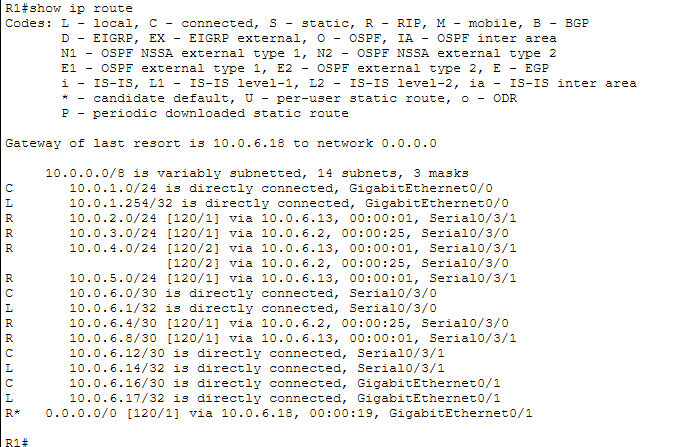

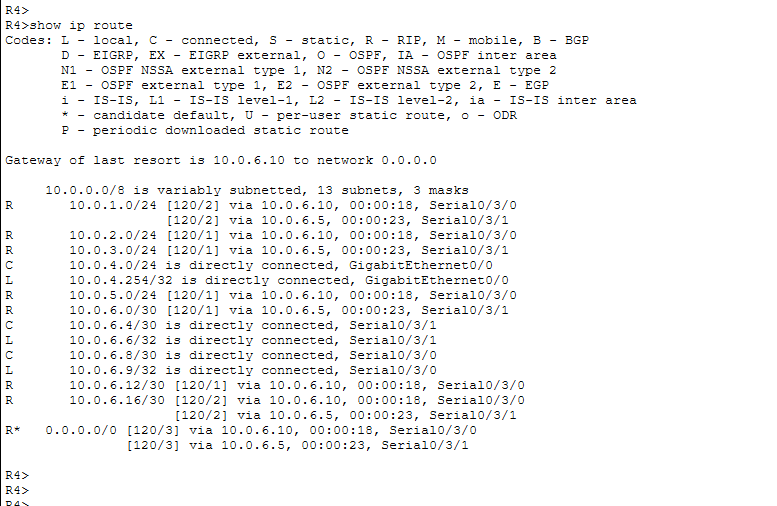

## 9. NAT/PAT configuration

PAT enables multiple internal hosts to share R5's external interface address, `203.0.113.1`. TCP/UDP port mappings or ICMP identifiers distinguish translated flows.

| NAT role | Interface | Address |
|---|---|---|
| Inside | Gi0/0/0 | 10.0.6.18/30 |
| Outside | Gi0/0/1 | 203.0.113.1/24 |

On R5:

```cisco
configure terminal
interface GigabitEthernet0/0/0
 ip nat inside
exit
interface GigabitEthernet0/0/1
 ip nat outside
exit
access-list 1 permit 10.0.1.0 0.0.0.255
access-list 1 permit 10.0.2.0 0.0.0.255
access-list 1 permit 10.0.3.0 0.0.0.255
access-list 1 permit 10.0.4.0 0.0.0.255
access-list 1 permit 10.0.5.0 0.0.0.255
ip nat inside source list 1 interface GigabitEthernet0/0/1 overload
end
write memory
```

The ACL selects the five internal LANs for translation and excludes backbone addresses. It is a NAT selection ACL, not an interface firewall policy. `overload` enables PAT instead of requiring a separate global address for each host.

[R5 NAT configuration](nat-pat/NAT-configuration-R5.txt)

### External connectivity and translation verification

From internal PCs:

```cmd
ping 203.0.113.10
tracert 203.0.113.10
```

On R5, immediately after generating traffic:

```cisco
show ip nat translations
show ip nat statistics
show access-lists
```

| Translation field | Meaning | Example |
|---|---|---|
| Inside local | Original internal host | 10.0.1.1 |
| Inside global | Translated internal host | 203.0.113.1 |
| Outside local | External host as seen internally | 203.0.113.10 |
| Outside global | Actual external host | 203.0.113.10 |

Port numbers and ICMP identifiers depend on the traffic generated. A successful ping alone does not prove translation; inspect the translation table and statistics.

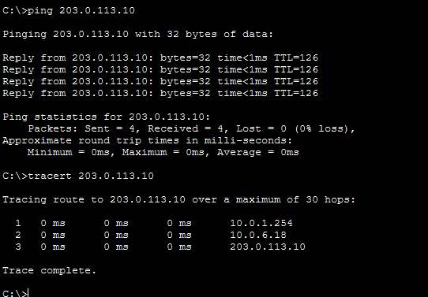


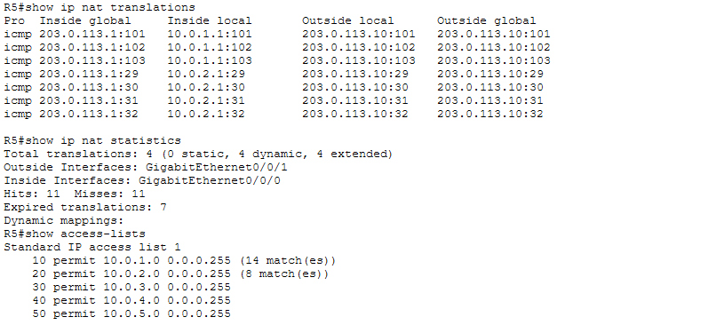


### HTTP application-layer test

Enable HTTP under the external server's Services tab. On CO-PC1, open Desktop → Web Browser and navigate to `http://203.0.113.10`.

The Cisco Packet Tracer default webpage was successfully loaded from CO-PC1, confirming external HTTP connectivity. The NAT translation table provides separate evidence of PAT operation.

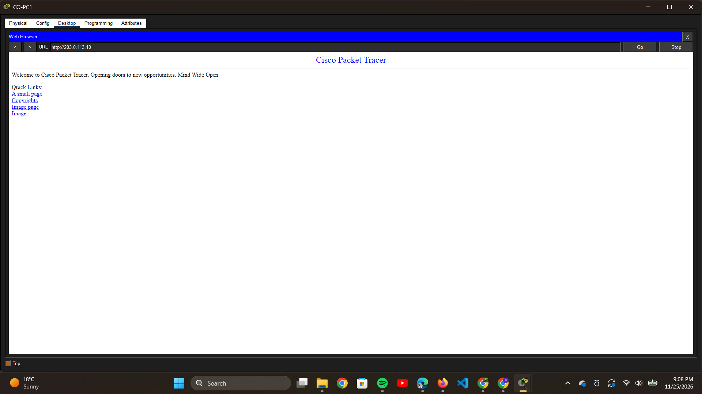

## 10. Reproduction and configuration exports

Open `dynamic-routing-ripv2.pkt` in Cisco Packet Tracer. The final simulation should have all backbone links restored and edge routing/NAT configured. To reproduce the internal-only routing baseline, start from the parent base simulation and apply Section 4 before Sections 8–9.

Optional full router configuration exports can be stored in `configurations/R1.txt` through `configurations/R5.txt` using `show running-config`. Remove any credentials before publishing.

## 11. Conclusion and limitations

RIPv2 provides automatic internal route discovery and supports equal-cost paths across the redundant campus backbone. The link failure experiment illustrates how alternate routes can preserve reachability after convergence. Default route propagation and NAT overload extend the design to a simulated external service, with successful HTTP access observed from CO-PC1.

RIP's hop-count metric, periodic updates and 15-hop limit make it less suitable for large or complex production networks. The single R5 uplink is not redundant. Packet Tracer results are educational simulation observations, not real Internet access or production performance measurements. Future OSPF and EIGRP implementations can reuse the topology and failure scenario for a controlled comparison.
