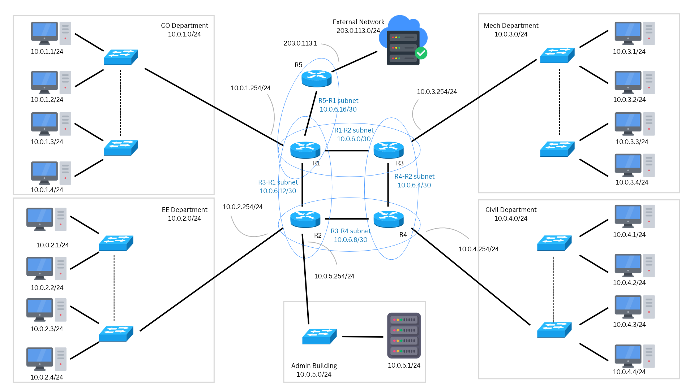
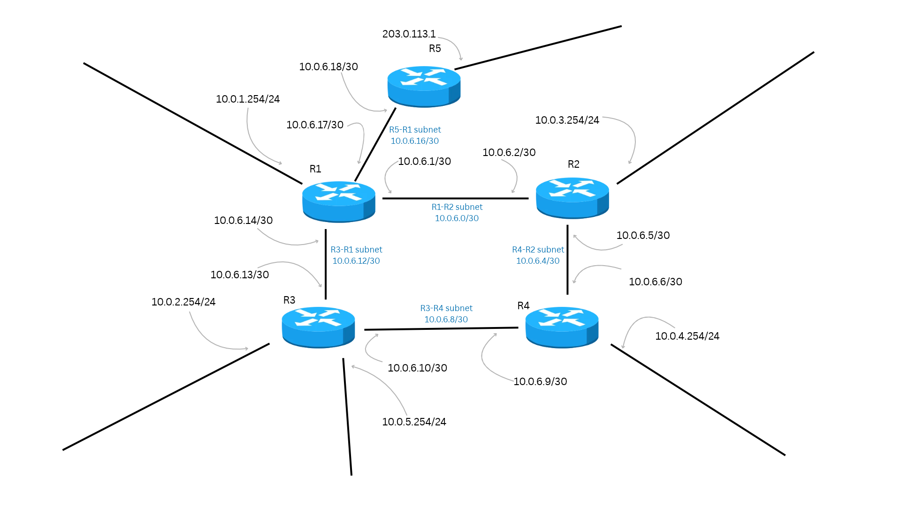

# Network Routing Simulations

A progressive investigation of computer network routing, redundancy, resilience and interoperability using Cisco Packet Tracer. This repository moves from fundamental static and dynamic routing to multi-router campus networks, comparative routing experiments and hybrid routing architectures.

## Project objectives

- Implement and verify static and dynamic IPv4 routing.
- Design redundant networks using subnetting and variable-length subnet masks (VLSM).
- Investigate route discovery, routing metrics, path selection and equal-cost multipath routing (ECMP).
- Evaluate network behaviour during backbone link failures and restoration.
- Demonstrate default routing, NAT/PAT and simulated external network access.
- Compare dynamic routing protocols under consistent experimental conditions.
- Explore interoperability through route redistribution and routing policies.

## Project roadmap

| Project | Scope | Status |
|---|---|---|
| [01 — Basic Routing](./01-basic-routing/) | Static routing, RIPv2 and inter-LAN connectivity | Completed |
| [02 — Multi-Router Network](./02-multi-router-network/) | Redundant campus architecture, RIPv2, OSPF, EIGRP, failure recovery and NAT/PAT | In progress |
| 03 — Comparative Routing Analysis | Convergence, packet loss, path selection and recovery measurements | Planned |
| 04 — Hybrid Routing | Multiple routing domains, redistribution and route preference | Planned |

## 01 — Basic Routing

Introduces routing between two departmental LANs using independent static routing and RIPv2 simulations. Routing tables and connectivity tests demonstrate the difference between manually configured and dynamically learned routes.

[Explore basic routing](./01-basic-routing/)

## 02 — Multi-Router Network

Extends the network into a redundant campus architecture with four departmental LANs, an administration server, four internal routers and an edge router connected to a simulated external server.





Each dynamic routing protocol uses an independent copy of the same base topology and addressing scheme.

| Protocol | Routing approach | Metric | Status |
|---|---|---|---|
| [RIPv2](./02-multi-router-network/ripv2/) | Distance vector | Hop count | Completed |
| OSPF | Link state | Cost | Planned |
| EIGRP | Advanced distance vector | Bandwidth and delay by default | Planned |

Experiments include routing table verification, interdepartmental connectivity, ECMP, traceroute, backbone failure and restoration, default route propagation, NAT/PAT and HTTP access.

[Explore the multi-router network](./02-multi-router-network/)

## 03 — Comparative Routing Analysis (Planned)

This stage will consolidate results from the independent protocol simulations rather than duplicate the network topology. The same source and destination, failed backbone link, interface settings and test procedure will be used wherever possible.

Measurements will include convergence and recovery time, packet loss during disruptions, route restoration and selected routing paths. Repeated trials and documented measurement conditions will support meaningful comparisons. Numerical results will be added only after measurements are collected.

## 04 — Hybrid Routing (Planned)

This stage will investigate the coexistence of multiple routing mechanisms within a single network, including static and dynamic routes, redistribution between routing domains, administrative distance, route filtering and loop prevention. The exact topology and redistribution policies will be defined during implementation.

## Repository structure

```text
network-routing-simulations/
├── README.md
├── .gitignore
├── 01-basic-routing/
├── 02-multi-router-network/
│   ├── README.md
│   ├── extended-network-base.pkt
│   ├── network-topology.png
│   ├── router-interface-addressing.png
│   ├── ripv2/
│   ├── ospf/                         # Planned
│   └── eigrp/                        # Planned
├── 03-comparative-routing-analysis/  # Planned
└── 04-hybrid-routing/               # Planned
```

## Tools and technologies

- Cisco Packet Tracer
- Cisco IOS CLI
- IPv4, VLSM, Ethernet and serial links
- Static routing, RIPv2, OSPF and EIGRP
- ICMP, traceroute, TCP/HTTP and NAT/PAT
- Git and GitHub for version control and documentation

## Running the simulations

1. Clone or download this repository.
2. Open a completed `.pkt` file in Cisco Packet Tracer.
3. Consult the corresponding project README for addressing, configuration and verification procedures.
4. Inspect routing tables using `show ip route` and test connectivity using `ping` and `tracert`.
5. Use a separate copy of the simulation when modifying configurations or reproducing failure experiments.

## Scope and limitations

This repository is an educational simulation environment, not a production network. Packet Tracer timing and protocol behaviour may differ from physical Cisco equipment. External connectivity is simulated using the documentation address range `203.0.113.0/24`; it does not represent real Internet access. Planned experiments are distinguished from completed implementations, and theoretical protocol characteristics are not presented as measured performance results.

## Author

Ruwanya Herath

